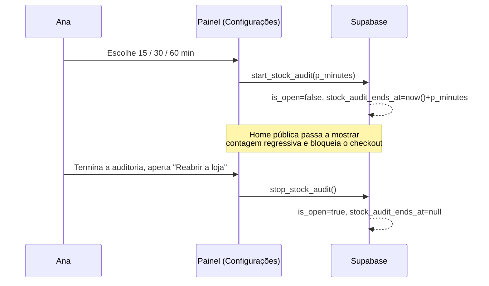

# ADR-0014 — Modo de auditoria de estoque (fechamento temporário com prazo)

- **Status:** Proposto
- **Data:** 2026-10-16

## Contexto

Hoje a loja já tem um "fechada temporariamente" (`store_settings.is_open = false`): quando
ligado, a vitrine permanece visível mas o carrinho mostra um aviso e bloqueia o checkout
(`cart_view.dart`, mensagem livre em `closed_message`). Esse aviso:

- só aparece no carrinho/checkout, não na **home**;
- não diz **quando** a loja volta — a Ana escreve isso à mão no texto (sujeito a erro,
  sem atualização automática);
- não dá ao cliente nenhuma previsão visual de tempo.

A Ana pediu uma função específica: ao atualizar o estoque (cadastrar peças novas, conferir
quantidades), ela liga um **modo de auditoria de estoque** com um prazo fixo —
**15, 30 ou 60 minutos** — e a home mostra uma contagem regressiva ao vivo até esse horário,
em vez de um texto solto.

## Decisão

- **Reaproveita `is_open`** como o único gatilho que bloqueia o checkout — nenhuma mudança em
  `create_order`, RLS ou no aviso já existente no carrinho (ADR-0006 continua valendo).
- **Novo campo** `store_settings.stock_audit_ends_at timestamptz null`: horário (absoluto, em
  UTC) em que a auditoria deveria terminar. `null` = não está em auditoria (comportamento de
  hoje, com `closed_message` livre, continua existindo para outros motivos de fechamento).
- **Duas RPCs pequenas** (iguais em espírito a `confirm_order`/`cancel_order`, mas sem
  transação complexa — só a Ana mexe nisso):
  - `start_stock_audit(p_minutes int)` — aceita só `15`, `30` ou `60`; faz
    `is_open = false`, `stock_audit_ends_at = now() + make_interval(mins => p_minutes)`.
  - `stop_stock_audit()` — `is_open = true`, `stock_audit_ends_at = null`.
  - **Por quê RPC e não `update` direto** (como já fazemos em `setCategoryActive`/
    `setActive` de produto): o prazo é calculado a partir de `now()` **do banco**, não do
    relógio do aparelho da Ana — evita a contagem regressiva do cliente mostrar um horário
    errado se o celular dela estiver com a hora desalinhada.
- **A contagem regressiva não reabre a loja sozinha.** Quando `stock_audit_ends_at` passa,
  a home continua mostrando o aviso (ex.: "a qualquer momento") até a Ana apertar **"Reabrir
  a loja"** (chama `stop_stock_audit`). Decisão deliberada: reabrir automaticamente arriscaria
  liberar pedidos com o estoque ainda incompleto, no meio da auditoria.
- **Home (`/`) passa a mostrar o aviso** quando `is_open = false`: se `stock_audit_ends_at`
  estiver preenchido, mostra "Atualizando o estoque — voltamos às HH:MM" com contagem ao vivo;
  senão, mostra o `closed_message` livre de hoje (fechamento por outro motivo).
- **Onde a Ana liga/desliga:** tela **Configurações** (`/admin/configuracoes`), hoje marcada
  "Em breve" no menu — essa é a primeira função a habilitá-la.

### Fluxo

## Alternativas consideradas

| Alternativa | Por que não |
|---|---|
| Ana escreve o horário à mão no `closed_message` (texto livre) | Sem contagem ao vivo; erro de digitação; não reabre sozinho nem avisa visualmente. |
| Calcular `stock_audit_ends_at` no Flutter (`DateTime.now().add(...)`) | Relógio do aparelho da Ana pode estar errado — o horário mostrado ao cliente ficaria errado. |
| Reabrir a loja sozinha quando o prazo zera (`pg_cron` ou checagem no client) | Risco de liberar pedidos com a auditoria de estoque ainda incompleta. |
| Campo de duração (ex. `stock_audit_minutes`) em vez de horário absoluto | Contagem regressiva no cliente teria que saber a hora de início também; horário absoluto é mais simples de exibir e já resolve fuso horário. |

## Consequências

- **+** Reaproveita 100% do bloqueio de checkout já existente (ADR-0006/`is_open`) — zero
  mudança em `create_order` ou nos testes já existentes do carrinho.
- **+** RLS nova: nenhuma (`store_settings` já é `select` público e `update` só admin).
- **+** Contagem regressiva no cliente é só leitura de um timestamp absoluto — sem polling,
  sem função agendada no banco.
- **−** Depende da tela **Configurações** existir (hoje "Em breve") — este ADR assume que ela
  será construída junto com esta função, não depois.
- **−** Se a Ana esquecer de desligar, a loja fica fechada indefinidamente. Mitigado pela
  contagem regressiva mostrar visualmente que o prazo já passou ("a qualquer momento"), o que
  é um lembrete mais forte que o fechamento mudo de hoje.
